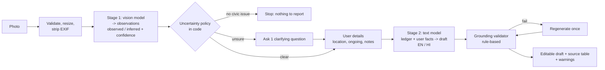

# CivicLens

*See a Problem. Report a Solution.*

**Code:** https://github.com/insanityatpeak/CivicLens · **Live demo:** https://civiclens-prns.onrender.com/ (free tier: the first load after idle can take about a minute)

Built by Priyanshu ([@insanityatpeak](https://github.com/insanityatpeak)): a photo-to-complaint assistant that shows where every claim in the draft comes from.

> **Status: working, deployed, not yet evaluated.** The full flow runs end to end with real models and is deployed on Render (free tier). 79 automated tests cover the logic, not model quality. There is no labeled photo set yet, so accuracy and Hindi quality are unmeasured; real-model runs so far are single smoke tests. See [Evaluation](#evaluation-results) and [Limitations](#limitations).

## The problem
Reporting a pothole, a garbage pile or stagnant water is a hassle: you must pick the right category, find the right department, write a convincing complaint, often in a language that is not your own, and include details (where? how long?) that you may not think about. So most issues go unreported.

## The solution
A citizen uploads a photo. CivicLens lists what the AI can **see** and what it only **assumes**, asks one short question if it is unsure, then writes an editable complaint **draft** in English or Hindi. Nothing is submitted anywhere; the user reviews, edits and sends it themselves.

## What makes it different: the evidence ledger
- **Every claim is traceable.** Each statement in the draft is tagged *Seen in photo*, *Assumed* or *You told us*.
- **It asks instead of guessing.** An unclear photo triggers a clarifying question; a photo with no civic issue gets a plain "nothing to report", not a forced label.
- **Code checks the AI.** A rule-based validator flags invented phone numbers, dates, departments, links and locations, claims that the complaint was "submitted", and inferences stated as fact. On failure the draft is regenerated once; remaining warnings are shown to the user.
- **Privacy-aware.** Photos are re-encoded (dropping EXIF/GPS), not stored by the app, and a warning appears if faces or number plates are reported.

*Screenshots: not yet captured. Architecture notes: [`docs/ARCHITECTURE.md`](docs/ARCHITECTURE.md).*

## AI/ML architecture

- **Two stages** separate *seeing* from *writing*: the writer never sees pixels, only ledger entries, so claims can be checked against ids.
- **Provider abstraction** (`ModelProvider`): Groq is the primary provider, with OpenRouter then Gemini as automatic fallbacks (a `FallbackChain` moves on only when a call fails: quota, network, refusal); swapping models does not touch app logic.
- **Demonstration fallback:** a clearly labeled, canned offline mode so the flow can be walked without a key. It is **not AI**, never looks at the photo, and only activates when you choose it.

## Technology stack
Python 3.12 · FastAPI + Uvicorn (backend) · vanilla HTML/CSS/JS single-page frontend (no build step) · Groq (primary), then OpenRouter, then Google Gemini as fallbacks (Groq and OpenRouter over OpenAI-compatible HTTPS via `httpx`; Gemini via `google-genai`); models configurable in `.env` · Pydantic · Pillow · pytest · ruff.

## Installation and setup
```
python -m venv .venv
.venv\Scripts\activate          # macOS/Linux: source .venv/bin/activate
pip install -r requirements.txt
copy .env.example .env          # macOS/Linux: cp .env.example .env
# edit .env: set GROQ_API_KEY (https://console.groq.com/keys), OPENROUTER_API_KEY (https://openrouter.ai/keys), GEMINI_API_KEY (https://aistudio.google.com/apikey)
```
Never commit `.env`. For development tools: `pip install -r requirements-dev.txt`.

## Run locally
```
uvicorn civiclens.web.server:app --app-dir src --port 8000
# then open http://localhost:8000
```
No key yet? Click **Use demonstration fallback** in the app (it appears when no key is set), or set `CIVICLENS_PROVIDER=mock`. Other commands:
```
python scripts/spike.py [image]                     # one real model call + Hindi check
python scripts/run_pipeline.py photo.jpg --lang hi  # full pipeline in the terminal
pytest                                              # 79 tests (logic, not model quality)
```

## How to use
1. Upload a photo of the problem and click **Analyze photo**.
2. Read the **evidence ledger**. Answer the question if one is asked.
3. Add where it is, whether it is ongoing, and any notes; pick English or Hindi.
4. Review and edit the draft, check *where each statement comes from*, then copy or download it (`.txt` / `.md`).
5. Find your local municipal body's official channel to send it. CivicLens does not know or verify contact details.

## Evaluation results
**No real evaluation has been run.** There is no labeled photo set yet, so there are no accuracy, latency or Hindi-quality numbers to report. Small single-run checks (not an evaluation) used real models: vision on the pothole, garbage and three user photos; English and Hindi drafts on two photos via Groq (all passed the validator); OpenRouter Hindi drafts N=8 (all passed after the automatic retry, median 7.6 s). Accuracy of photo reading against labels has not been measured. The harness exists and is tested: `python eval/run_eval.py --split test` (see [`eval/REPORT.md`](eval/REPORT.md) for the dataset checklist, method and threats to validity). Runs on the demonstration fallback are stamped *harness test only*.

What *is* verified (see `docs/PROJECT_STATE.md` for exact commands and outputs): 79 unit and HTTP-level tests pass, including injected fabrications being caught by the validator and provider fallback order; lint is clean; install works in a fresh virtual environment; a scan found no secrets in the tree or git history. These tests use a scripted or canned provider, so they say nothing about model quality.

## Limitations
- Real-model behavior is barely measured: category accuracy from real photos, the vision prompt, Hindi quality (readable to the assistant, not reviewed by a native speaker), and whether generating Hindi directly beats translating are all **unmeasured**.
- The validator is pattern-based. It catches the listed fabrication types but cannot prove a draft is faithful.
- Only English and Hindi. Only still photos. No location from the photo (EXIF is stripped on purpose).
- Face and number-plate **blurring is not implemented**; the app only warns.
- The per-session usage cap is soft, not a global rate limit. A shared API key on a public deployment can still be exhausted.
- The UI was checked in headless Chromium (desktop and mobile widths, keyboard-only flow, automated accessibility scan). Not checked: Safari, Firefox, a real phone camera, any screen reader.
- Free-tier limits are the practical ceiling: Groq about 1,000 output tokens per minute for the default model, OpenRouter free models 50 requests per day (both observed while testing). A shared public demo would exhaust them quickly.
- Deployed on a free Render instance with shared API keys: it can sleep when idle and can hit provider rate limits. The OpenRouter fallback has been verified only on a single forced-failover run.

## Responsible AI and privacy
- Output is a **prediction and a draft**, never a confirmed finding or an official submission. No government system is contacted.
- The model is told not to identify people or invent locations, dates, injuries, severity, departments or contact details; code enforces this.
- Photos are processed in the session and not stored by CivicLens. Note that the model provider receives the image to analyze it, and photos may contain faces or number plates.
- Secrets live in environment variables only.

## Future enhancements
Verified links to official reporting channels; more Indian languages; face and plate blurring; optional geotagging from EXIF with explicit consent; bring-your-own-key and server-side rate limiting; a citizen-to-authority feedback loop.

## AI-assisted development disclosure
This project was built with AI coding assistance (Claude Code) for planning, implementation and testing; the runtime models are listed under Technology stack. All behavior claimed in this README was checked by running the code, and gaps are listed under Limitations.

## License
No license file has been added yet, so all rights are reserved by default.

## Acknowledgments
Sample image sources and licenses: see `data/SOURCES.md` (no images added yet).
